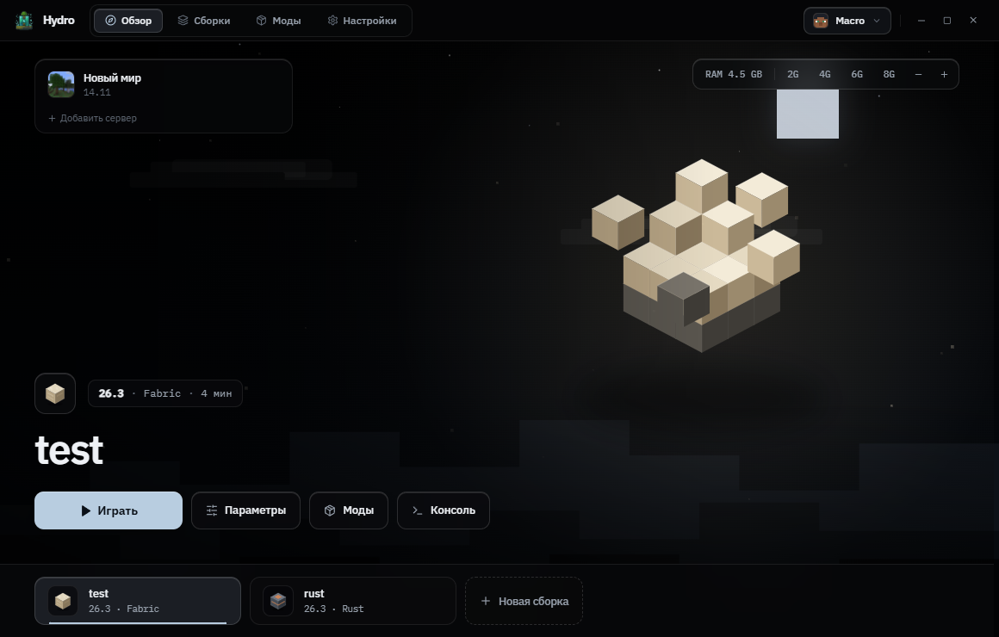
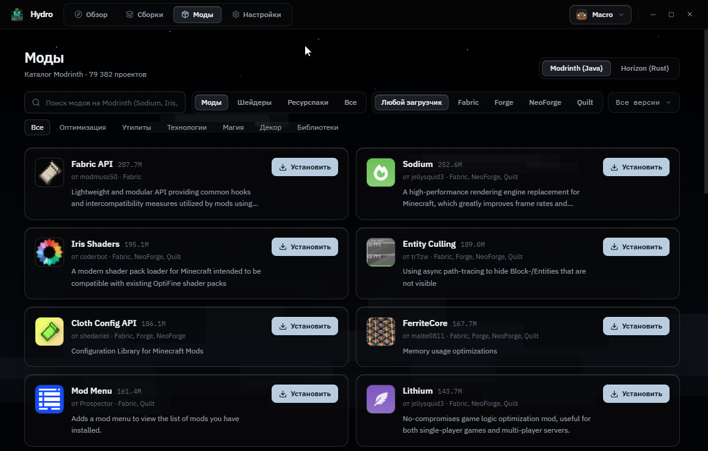
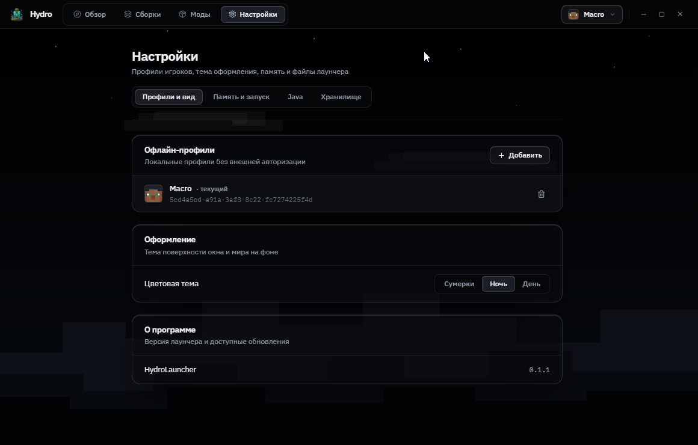
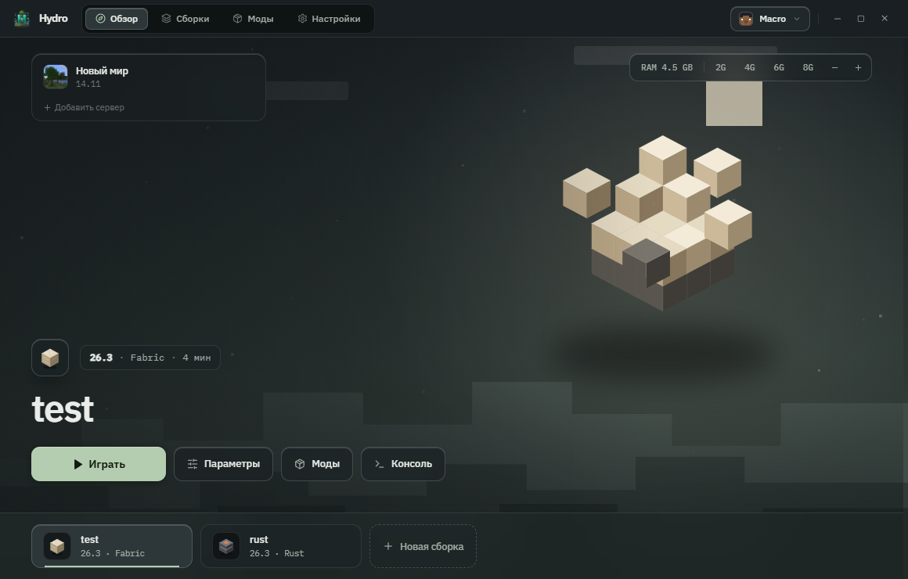
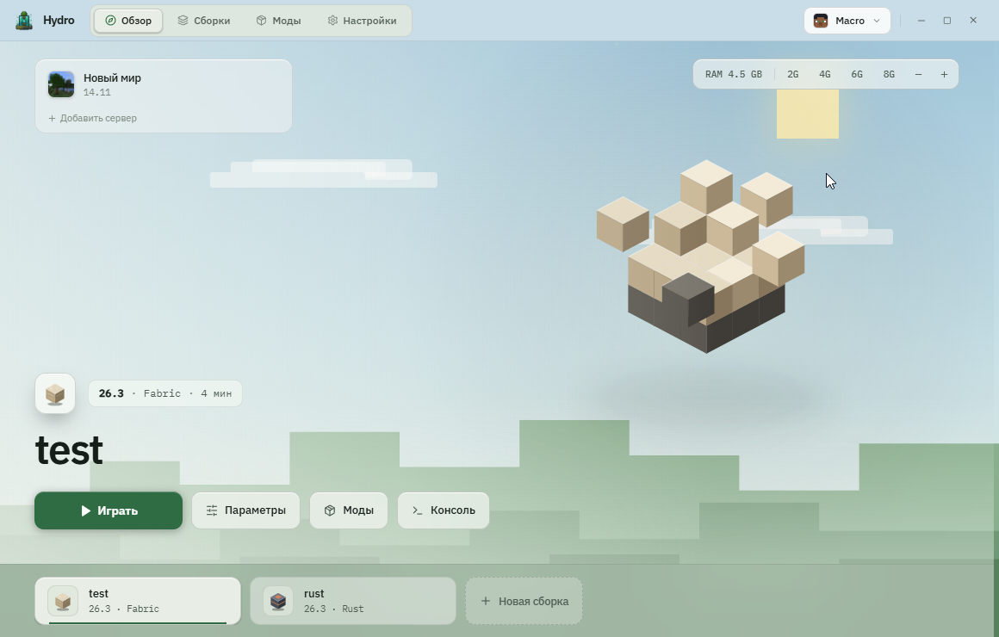

# HydroLauncher

[](https://github.com/nnnegrvpeni-lang/HydroLauncher/releases/latest)
[](https://github.com/nnnegrvpeni-lang/HydroLauncher/actions/workflows/release.yml)

Десктопный лаунчер Minecraft на базе **Tauri v2 + React 19 + Rust** с интерфейсом в стиле «жидкое стекло». Поддерживает классическую **Java Edition** (Vanilla, Fabric, Forge, NeoForge, Quilt) и нативный Rust-движок **Horizon**.

---

## Скриншоты



| Сборки | Каталог модов (Modrinth) |
| --- | --- |
|  |  |



<details>
<summary>Другие темы оформления («Сумерки» и «День»)</summary>

| Сумерки | День |
| --- | --- |
|  |  |

</details>

---

## Возможности

- **Изолированные сборки** — отдельные папки игры, миры, моды, шейдеры, ресурспаки, скриншоты и параметры для каждого профиля.
- **Модлоадеры Java Edition** — автоматическая установка **Vanilla**, **Fabric**, **Forge**, **NeoForge** и **Quilt**.
- **Интеграция с Modrinth** — поиск и установка модов, шейдеров, ресурспаков и модпаков (`.mrpack`), автоматическое разрешение зависимостей, переключение версий и проверка обновлений.
- **Поддержка Horizon (Rust)** — запуск сборок на нативном движке Horizon, выбор версии бинарников с отдельным хранением для каждого релиза, автообновление Nightly-сборок и каталог модов Horizon (`.hmod`, `.hnmod`, `.hshader`, `.zip`).
- **Автоопределение и скачивание Java** — автоматический поиск установленной Java (управляемой или системной) и загрузка подходящей версии **Adoptium Temurin JRE** при её отсутствии.
- **Изолированная консоль** — отдельные логи для каждой сборки с копированием и очисткой прямо в окне сборки и на главной странице.
- **Быстрый запуск (Quick Play)** — быстрый вход в сохранённые миры и на серверы с главной страницы.
- **Миры и резервные копии** — вкладка «Миры» в карточке сборки: размер и дата каждого мира, zip-бэкап в папку `backups/` и удаление с подтверждением.
- **Дублирование и экспорт** — копия сборки вместе с модами, конфигами и мирами, а также экспорт в `.mrpack` для Modrinth.
- **Трей и отчёты о крашах** — иконка в системном трее, настройка «сворачивать в трей при закрытии» и окно с кодом возврата и хвостом лога при аварийном завершении игры.
- **Офлайн-профили** — локальные аккаунты (`OfflinePlayer:<name>`, UUID v3) без привязки к внешним серверам авторизации.
- **Два языка интерфейса** — русский и английский с переключением в настройках без перезапуска.
- **Темы оформления** — «Сумерки», «Ночь» и «День» с полупрозрачными стеклянными панелями и фоном мира.
- **Проверка обновлений** — тихое уведомление о новой версии лаунчера со ссылкой на страницу релиза.

---

## Стек технологий

- **Frontend:** React 19, TypeScript, Vite 6, Tailwind CSS v4, Zustand, Lucide Icons
- **Backend:** Tauri v2, Rust, `tokio`, `reqwest`, `serde`
- **Хранилище:** локальные JSON-файлы с атомарной записью (`write temp + rename`)

---

## Структура проекта

```text
HydroLauncher/
├── index.html                        # Точка входа Vite
├── package.json                      # Скрипты и зависимости фронтенда
├── LICENSE                           # Лицензия MIT
├── src/                              # Frontend (React + TypeScript)
│   ├── api/                          # Обёртка над Tauri IPC, события и mock-режим для браузера
│   ├── components/                   # UI-компоненты и модальные окна
│   │   ├── ui/                       # Базовые элементы (Button, Modal, Switch, ProgressBar, EmptyState)
│   │   ├── TitleBar.tsx              # Кастомная шапка окна, навигация и быстрый профиль
│   │   ├── ToastHost.tsx             # Всплывающие уведомления о прогрессе и ошибках
│   │   ├── CrashReportModal.tsx      # Отчёт об аварийном завершении игры
│   │   ├── CreateInstanceModal.tsx   # Создание сборки (версия, лоадер, Horizon, .mrpack)
│   │   ├── InstanceModsModal.tsx     # Детали сборки: моды, шейдеры, ресурспаки, миры, скриншоты, логи
│   │   ├── InstanceSettingsModal.tsx # Настройки сборки (память, Java, аргументы JVM)
│   │   ├── LogConsole.tsx            # Консоль вывода процесса игры
│   │   └── VoxelStageCanvas.tsx      # 3D/воксельная сцена на главной странице
│   ├── pages/
│   │   ├── HomePage.tsx              # Главная страница с выбранной сборкой и Quick Play
│   │   ├── InstancesPage.tsx         # Сетка сборок с фильтрами и быстрым запуском
│   │   ├── ModsPage.tsx              # Каталог модов (Modrinth + Horizon)
│   │   └── SettingsPage.tsx          # Общие настройки, память, Java, тема, обновления Horizon
│   ├── stores/                       # Состояние приложения (Zustand)
│   ├── i18n/                         # Локализация RU/EN (словарь и хук useI18n)
│   └── theme.css                     # Токены темы, эффекты стекла и фон мира
│
└── src-tauri/                        # Backend (Rust + Tauri v2)
    ├── Cargo.toml                    # Зависимости Rust
    ├── tauri.conf.json               # Конфигурация окна и сборки Tauri
    └── src/
        ├── config/endpoints.rs       # Централизованные URL внешних API (Mojang, Modrinth, Adoptium, Horizon)
        ├── storage/                  # Централизованные пути (paths.rs) и атомарный JSON (json_store.rs)
        ├── models/                   # Структуры данных и событий
        ├── commands/                 # Tauri-команды, вызываемые с фронтенда
        └── services/                 # Бизнес-логика (загрузка, Java, лоадеры, Modrinth, Horizon, запуск)
```

---

## Запуск и разработка

### Требования

- [Node.js](https://nodejs.org/) 20+
- [Rust](https://www.rust-lang.org/) (актуальная stable-версия)
- Системные зависимости для [Tauri v2](https://v2.tauri.app/start/prerequisites/)

### Установка и запуск в dev-режиме

```sh
npm install
npm run tauri dev
```

### Проверка и сборка

```sh
# Проверка TypeScript и сборка фронтенда
npx tsc -b
npm run build

# Проверка и тесты Rust-бэкенда
cargo check --manifest-path src-tauri/Cargo.toml
cargo test --manifest-path src-tauri/Cargo.toml

# Сборка установщика / релизного бинарника
npm run tauri build
```

---

## Релизы

Релизы собираются автоматически: пуш тега `v*` запускает workflow
[`.github/workflows/release.yml`](.github/workflows/release.yml) на `windows-latest`,
который собирает портативный `.exe`, установщики NSIS и MSI и прикрепляет их к
релизу. Список изменений — в [CHANGELOG.md](CHANGELOG.md).

---

## Лицензия и правила использования

Проект распространяется под лицензией **[MIT](LICENSE)**.

### Что можно
- Бесплатно скачивать, запускать и использовать в личных или коммерческих целях.
- Изучать исходный код, изменять его и делать форки.
- Распространять оригинальную или модифицированную версию при условии сохранения текста лицензии `LICENSE` и уведомления об авторских правах.

### Что нельзя / ограничения
- **Без гарантий:** программное обеспечение предоставляется «как есть» (`AS IS`), авторы не несут ответственности за возможные сбои или потерю данных.
- **Сторонние сервисы и бренды:** HydroLauncher не является официальным продуктом Mojang Studios или Microsoft и не аффилирован с ними. Для игры и загрузки ресурсов соблюдайте правила соответствующих платформ (Minecraft EULA, Modrinth, Adoptium, Horizon).
